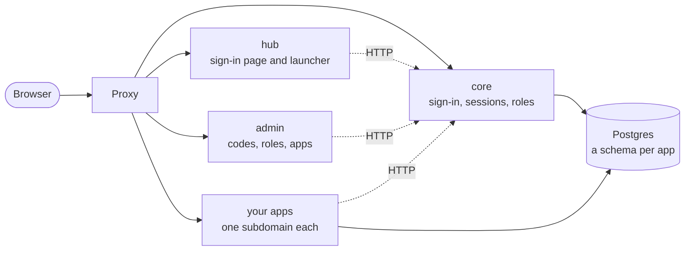

# robkit

robkit is a kit for self-hosting small apps for your friends and family. It makes a monorepo, called an install, with sign-in, a launcher, an admin page and one Postgres built in, and `robkit add` drops in apps that already have auth, their own database schema and their own subdomain.

Guests sign in with an access code you give them. You decide which roles may open which app. Each app gets a viewer from robkit and never handles a password or a cookie itself.

## Quickstart

You need Node 24, pnpm, Docker, and Linux or macOS. On Windows, run everything in WSL (see [CONTRIBUTING](CONTRIBUTING.md#on-windows-use-wsl)).

```sh
npm create robkit my-install
cd my-install
pnpm dev
```

`npm create robkit` asks which stack the example app should use, then writes the install, installs its dependencies and makes its first commit. It says how to get pnpm if you don't have it.

robkit's packages aren't on npm until its first release. Until then, or to work on robkit itself, make an install from a clone of this repo. The install links to the clone:

```sh
git clone https://github.com/RobertScholey98/robkit.git
cd robkit
corepack enable                                   # gives you the pnpm version robkit pins
pnpm install
pnpm create-install ../my-install --stack start   # or leave out the arguments, and it asks
cd ../my-install
pnpm dev
```

`pnpm dev` starts Postgres in Docker, then core, the hub, admin and the example app, each on its own subdomain:

- Open http://hub.robkit.localhost:3000 and claim the install: pick the owner's username and a password of 12 characters or more. You are now the owner.
- Open http://admin.robkit.localhost:3000 to make access codes and roles. Every new install has an access code, `test`, for signing in as a guest. It works only while the install runs on a `.localhost` domain.
- Open http://example.robkit.localhost:3000 to see the example app. Only the owner may open it until you change its rule in admin.

Add an app of your own. Leave `pnpm dev` running, and in another terminal in the install's folder:

```sh
pnpm robkit add notes --stack react-hono --access open   # or pnpm robkit add, and it asks
```

`pnpm dev` starts the new app, and `robkit add` prints its address: http://notes.robkit.localhost:3000. It is in `apps/notes`, with its own Postgres schema. Its `AGENTS.md` describes its stack.

When you're ready to host it, the install's `docs/deploy.md` walks through deploying to Coolify.

## What's in an install



- **Core** is the backend. It holds the owner, access codes, sessions, roles and which apps each role may open, and it signs every session token.
- **The hub** is where people sign in and open apps. **Admin** is where the owner manages codes, roles and apps.
- **Your apps** live in `apps/<slug>`, each on `<slug>.<domain>`. Each app's adapter checks who is asking and hands its handlers the viewer: the owner, a guest with roles, or nobody.
- **One Postgres** holds core's schema and one schema per app. Each app's database role reaches its own schema and nothing else.
- **The proxy** routes each subdomain to its app: `robkit-dev` on port 3000 locally, and Traefik behind Coolify in production.

Every install uses the same tools: pnpm, Drizzle, shadcn on Base UI, ESLint with Prettier, Husky with lint-staged, and Vitest. An app can be built on TanStack Start, React with Hono, React with Express, Next.js, or React with a Go server.

## Learn more

- [CONTRIBUTING.md](CONTRIBUTING.md): setting up, the gates, and how to propose a change, with or without a ticket.
- [docs/architecture.md](docs/architecture.md): how a request and a session token flow, and which package depends on which.
- [docs/adr/](docs/adr/README.md): the settled decisions and why we made them.
- [GLOSSARY.md](GLOSSARY.md): the words robkit uses, such as install, owner, guest, role and viewer.
- [SECURITY.md](SECURITY.md): how to report a vulnerability, and what an imported app can and can't do.
- The packages, each with its own README:

| Package                                   | What it does                                                                                                                                                       |
| ----------------------------------------- | ------------------------------------------------------------------------------------------------------------------------------------------------------------------ |
| [`create-robkit`](packages/create-robkit) | `npm create robkit`, and the `robkit` command an install runs                                                                                                      |
| [`@robkit/core`](packages/core)           | Core, the backend                                                                                                                                                  |
| [`@robkit/session`](packages/session)     | Session tokens and the request guard                                                                                                                               |
| [`@robkit/input`](packages/input)         | Readers for input from outside robkit: env, JSON, slugs, the manifest; `InputProblem`, `orExit` and `orThrow`; an install's addresses and the headers robkit sends |
| [`@robkit/guard`](packages/guard)         | The pure decision of who may open an app                                                                                                                           |
| [`@robkit/hono`](packages/hono)           | The Hono adapter                                                                                                                                                   |
| [`@robkit/express`](packages/express)     | The Express adapter                                                                                                                                                |
| [`@robkit/next`](packages/next)           | The Next.js adapter                                                                                                                                                |
| [`@robkit/start`](packages/start)         | The TanStack Start adapter                                                                                                                                         |
| [`@robkit/react`](packages/react)         | `sessionFetch`, for calls from the page when a session lapses                                                                                                      |
| [`@robkit/drizzle`](packages/drizzle)     | `appDatabase()`, an app's Drizzle database, and `robkit-migrate`, which migrates its schema                                                                        |
| [`@robkit/serve`](packages/serve)         | What every server does in production: listen, answer the built files and stop on SIGTERM. Each adapter's `/serve` is built on it                                   |
| [`robkit/go`](go)                         | The Go module: the guard and request guard for a React + Go app, ported to Go                                                                                      |
| [`@robkit/dev`](packages/dev)             | `robkit-dev`, the runner and proxy behind `pnpm dev`                                                                                                               |
| [`@robkit/provision`](packages/provision) | Each app's Postgres schema and role, for core in production and for `pnpm dev`                                                                                     |
| [`@robkit/vite`](packages/vite)           | `robkit()`, which sets a Vite app's dev server up behind `pnpm dev`, and Express's dev handoff                                                                     |

## Contributing

[CONTRIBUTING.md](CONTRIBUTING.md) covers setting up, the fast and full gates, a worked first change, and how tickets, branches and commits work here.

## Licence

[MIT](LICENSE).
