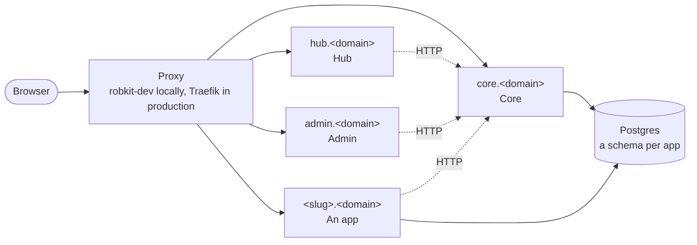
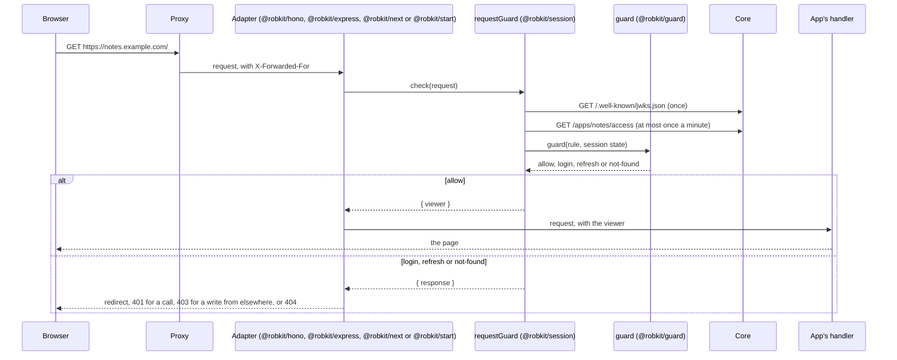
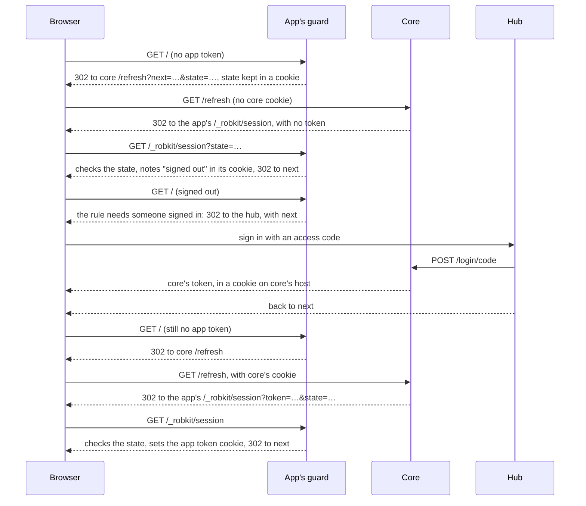
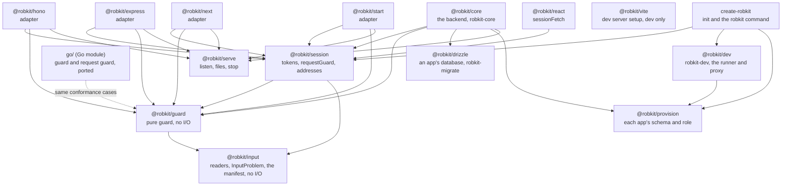
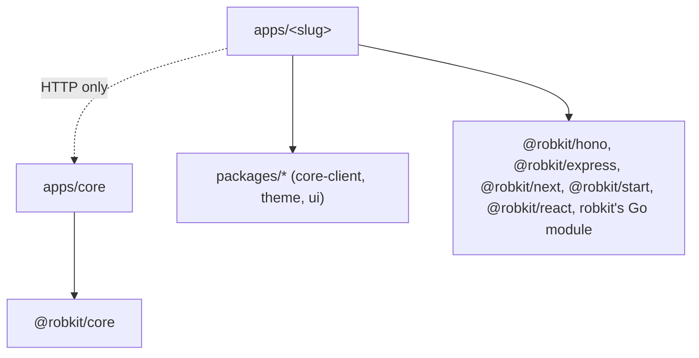

# Architecture

This page shows how an install fits together: how a request reaches an app, how session tokens move between core and the apps, which package depends on which, and where to look for each concern. The words are the ones in [`GLOSSARY.md`](../GLOSSARY.md). The reasons behind each choice are in [`docs/adr/`](adr/README.md).

## An install

An install is one domain, one Postgres, core, the hub, admin and the owner's apps. Each app answers on its own subdomain, `<slug>.<domain>`. One proxy sits in front of them all: `robkit-dev`'s proxy on port 3000 in local dev, and Traefik behind Coolify in production.

- **Core** is the only code that reads or writes the core tables and the only holder of the signing key ([ADR 0001](adr/0001-core-owns-the-core-tables.md)).
- **The hub** is where people sign in and launch apps. **Admin** is where the owner manages access codes, roles and apps. Both are React pages that call core from the browser through `callCore`.
- **An app** has its own Postgres schema and role ([ADR 0007](adr/0007-one-schema-and-role-per-app.md)) and reaches core over HTTP only.
- Only the proxy may reach core, because core trusts its forwarded headers for the sign-in limit ([ADR 0012](adr/0012-only-the-proxy-reaches-core.md)).

## How a request flows

Every request to an app passes through its adapter, which runs `requestGuard` from `@robkit/session`. `requestGuard` reads the app's cookie, verifies the app token against core's public key, gets the app's access rule from core, and asks the pure guard what to do. The app's handlers only run when the guard allows the request, and they get the viewer from the adapter.

The guard knows the app's own address from its settings, not from the request. The guard reads `ROBKIT_APP` and `ROBKIT_CORE_URL` itself, so an app calls `guarded()` with no settings. The app's origin is core's origin, from `ROBKIT_CORE_URL`, with the app's slug in place of `core`: the same protocol and port, on `<slug>.<domain>`. `appOrigin` in `@robkit/session` works it out, and Go's `Guarded` the same way. Every URL the guard sends the browser to, the `next` it gives core and the hub, its callback and its refresh path, is that origin plus the request's path and query. Neither port reads `Host`, `X-Forwarded-Host` or `X-Forwarded-Proto` for it, so a proxy hop that rewrites one changes nothing, and a request with no `Host` is guarded like any other.

The guard's four outcomes come from one table in `packages/guard/src/guard.ts`:

| Who is asking          | Open    | Gated to roles | Owner only |
| ---------------------- | ------- | -------------- | ---------- |
| Unknown (no token yet) | refresh | refresh        | refresh    |
| Token expired          | refresh | refresh        | refresh    |
| Core said signed out   | allow   | login          | login      |
| The owner              | allow   | allow          | allow      |
| A guest with a role    | allow   | allow          | not-found  |
| A guest without one    | allow   | not-found      | not-found  |

A page load that gets `login` or `refresh` is redirected. A call from the page (a `fetch`, or a Start server function) gets a 401 with a `Robkit-Session` header instead, and `sessionFetch` from `@robkit/react` sends the browser on. A form posted as a page load gets the same status with a small HTML page, whose one link goes through `/_robkit/refresh` back to the form's page. `not-found` is a real 404, so a guest can't tell an app they may not open from one that doesn't exist.

Before it reads the session, the guard refuses a write from another origin with a 403, since a browser sends an app's cookie with a form posted from a sibling app. [SECURITY.md](../SECURITY.md#no-sibling-app-can-write-as-the-viewer) has the rule.

## How tokens flow

Core keeps each session. Core's own session token, with the audience `core`, sits in a host-only cookie on `core.<domain>`. Each app, admin included, holds its own app token, with its slug as the audience, in a host-only cookie on its own host. No cookie goes on the parent domain ([ADR 0004](adr/0004-per-app-tokens.md)). On an https install each cookie is named with the `__Host-` prefix, `__Host-robkit_session` and `__Host-robkit_state`, which a browser refuses to set with a `Domain`, so no app can plant one for another host. A local http install keeps `robkit_session` and `robkit_state`. `sessionCookies(origin)` in `@robkit/session` gives the names. Tokens last 15 minutes; a session lasts 30 days.

### Signing in and getting an app token

Core mints a token at `/refresh` only when `next` is on the exact origin of admin or an app in its catalog: protocol, host and port, which core works out from its own origin, `ROBKIT_CORE_URL`. The hub sends the browser back after sign-in only to an app's exact origin too.

If the app is open to anyone and nobody is signed in, the guard keeps core's word that nobody is signed in for a minute and lets the visitor in as nobody.

### Refreshing a lapsed token

When an app token expires, a page load goes back through core's `/refresh` as above, and core mints a fresh one while the session lives. A call from the page gets the guard's 401 instead. `sessionFetch` sends the browser to the app's `/_robkit/refresh`, which goes through core and comes back to the page. Core renews only from its own cookie, never from an app token, and core's own token is reissued on every `/refresh`.

## The package map

Arrows point from a package to what it imports when it runs. Adapters never import core: code reaches core over HTTP only. `tooling/eslint/package-graph.js` lists every edge, tests' included, and `tooling/eslint` enforces each arrow that is a rule (see [`AGENTS.md`](../AGENTS.md#the-layer-rule)). Every package here but `@robkit/react`, `@robkit/hono`, `@robkit/express` and the Go module, which imports only Go's standard library, also imports `@robkit/input`, which imports nothing. Hono and Express take it in their tests only. The map draws only the guard's and session's arrows to it.

In an install, the app side has its own layer rule, which `robkit check` enforces:

## Where to look

| Concern                                                         | Where                                                                                                                  |
| --------------------------------------------------------------- | ---------------------------------------------------------------------------------------------------------------------- |
| Who may open an app                                             | `packages/guard/src/guard.ts`, and the cases in `packages/guard/conformance.json`                                      |
| Reading cookies, verifying tokens, `/_robkit/*`                 | `packages/session/src/request-guard.ts`                                                                                |
| The same, for a Go app                                          | `go/session/guarded.go` and `go/guard/guard.go` (see `go/README.md`)                                                   |
| Token claims and cookies                                        | `packages/session/src/session-token.ts`, `session-cookies.ts`                                                          |
| Reading env, JSON, slugs and the manifest                       | `packages/input/src/` (`@robkit/input`), and `docs/conventions/input.md`                                               |
| An install's addresses                                          | `packages/input/src/addresses.ts` (`@robkit/input/addresses`)                                                          |
| What an app declares in its manifest                            | `packages/input/src/manifest.ts` (`@robkit/input`)                                                                     |
| Core's routes                                                   | `packages/core/src/routes/`, mounted in `app.ts`                                                                       |
| Core's tables                                                   | `packages/core/src/schema.ts`, migrations in `packages/core/drizzle/`                                                  |
| Sessions, refresh and minting app tokens                        | `packages/core/src/session-store.ts`, `packages/core/src/mint-token.ts`                                                |
| Access codes, roles and the app catalog                         | `packages/core/src/access-codes.ts`, `roles.ts`, `apps.ts`                                                             |
| The sign-in limit                                               | `packages/core/src/rate-limit.ts`, `client.ts`, `sign-in-limits.ts`, `password.ts`                                     |
| `pnpm dev`: finding apps, the proxy, the runner                 | `packages/dev/src/apps.ts`, `proxy.ts`, `runner.ts`                                                                    |
| `pnpm dev`: its checks before it starts, and each app's `.env`  | `packages/dev/src/checks.ts`, `app-env.ts`                                                                             |
| `robkit add` and `robkit migrate` reaching a running `pnpm dev` | `packages/dev/src/requests.ts`, `request-server.ts`                                                                    |
| An app's dev server and build config                            | `packages/vite/src/robkit.ts` and `express.ts` (`@robkit/vite`), `packages/next/src/config.ts` (`@robkit/next/config`) |
| The headers robkit sends                                        | `packages/input/src/headers.ts` (`@robkit/input/headers`), and `go/session/` for Go                                    |
| Each app's schema and role                                      | `packages/provision/src/provision.ts` (`@robkit/provision`)                                                            |
| An app's database and migrations                                | `packages/drizzle/src/app-database.ts`, `migrate.ts` (`@robkit/drizzle`)                                               |
| Serving an app in production                                    | `packages/serve/src/` (`@robkit/serve`), and each adapter's `src/serve.ts`                                             |
| How core starts and stops                                       | `packages/core/src/robkit-core.ts`, `serve-core.ts`, and `packages/serve/src/listen.ts`                                |
| What init writes                                                | `packages/create-robkit/src/generate.ts`, templates in `packages/create-robkit/templates/`                             |
| `robkit add`                                                    | `packages/create-robkit/src/add.ts`, `add-wizard.ts`                                                                   |
| `robkit upgrade`                                                | `packages/create-robkit/src/upgrade.ts`, and `upgrade-handover.ts`, frozen once 0.1.0 is on npm                        |
| Releasing robkit                                                | `.github/workflows/release.yml`, `tooling/repo-checks/src/release*.ts`                                                 |
| The install's layer rule                                        | `packages/create-robkit/src/check.ts`                                                                                  |
| Deploying to Coolify                                            | `packages/create-robkit/src/coolify-*.ts`, `deployment.ts`                                                             |
| The hub and admin                                               | `packages/create-robkit/templates/base/apps/hub`, `apps/admin`                                                         |
| robkit's own layer rule                                         | `tooling/eslint/layers.js`, `core-schema.js`                                                                           |
| The whole-stack test                                            | `tooling/e2e/src/`                                                                                                     |
